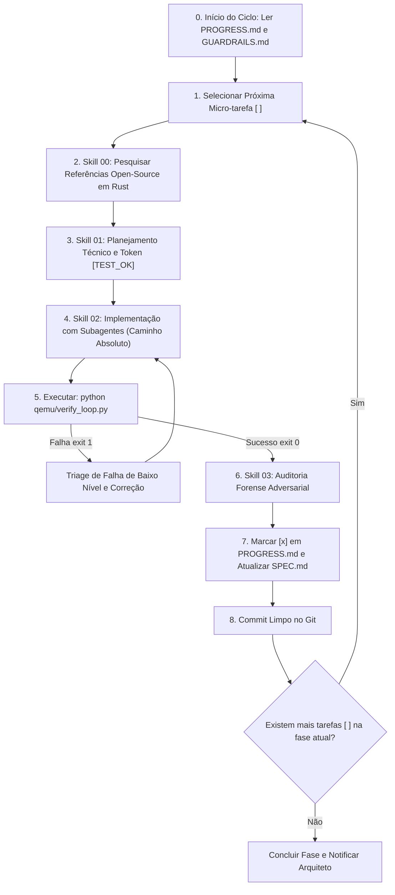

# Workflow: Loop Autônomo Contínuo do HybridOS (`/hybridos_loop`)

Este workflow orquestra o ciclo contínuo de desenvolvimento, verificação determinística e auditoria adversarial do **HybridOS Kernel**.

---

## Ciclo de Execução Contínua



---

## Protocolo Detalhado de Cada Passo

### Passo 0: Inicialização e Carregamento de Memória
- Ler `PROGRESS.md` (`C:\Users\Vinicius\Documents\HybridOS-Kernel\PROGRESS.md`).
- Ler `.agents/GUARDRAILS.md` para garantir que as 4 Regras Supremas e invariantes de baixo nível estão ativas.

### Passo 1: Seleção de Tarefa
- Selecionar rigorosamente a PRIMEIRA micro-tarefa pendente marcada com `[ ]`.
- Focar exclusivamente nessa tarefa (nunca tentar fazer múltiplas tarefas ao mesmo tempo).

### Passo 2: Pesquisa Open-Source (Skill `00_research_opensource_rust.md`)
- Consultar soluções consolidadas em Rust:
  - Asterinas, Redox OS, Aero OS (Kernel, ABI, VFS, Paging, VirtIO).
  - `uutils/coreutils` e `nushell` (Comandos de Terminal, Tri-Shell, Pipes).
  - COSMIC Desktop Apps, Orbital, `fontdue` (Renderização gráfica, janelas, tipografia).
  - Goblin, Wine, ReactOS (PE32+, relocação, IAT, DirectX translation).

### Passo 3: Planejamento Técnico (Skill `01_research_and_plan.md`)
- Inspecionar as assinaturas atuais em `C:\Users\Vinicius\Documents\HybridOS-Kernel\rust-kernel\src\`.
- Definir o token de auto-teste serial que a tarefa emitirá durante o boot (ex: `[TEST_OK] GFX_CRYSTAL_GLASS_SHADER`).

### Passo 4: Implementação Modular (Skill `02_parallel_implement.md`)
- Fornecer explicitamente o caminho absoluto `C:\Users\Vinicius\Documents\HybridOS-Kernel\rust-kernel` no topo de qualquer instrução a subagentes.
- Escrever código limpo em Rust `#![no_std]`, adicionando comentários `// SAFETY:` em blocos `unsafe`.
- Escrever o teste `self_test()` que valida a funcionalidade real e emite o token serial de auto-teste.

### Passo 5: Validação Determinística do Loop
- Executar o validador oficial do loop:
  ```powershell
  python qemu/verify_loop.py
  ```
- O script realiza:
  1. `cargo build --release --target x86_64-unknown-none`.
  2. `python qemu/build_disk.py`.
  3. Boot headless no QEMU com captura serial para `qemu/serial_latest.log` (timeout 15s).
  4. Validação do estado `[GUI] HybridOS Desktop Environment & PS/2 Mouse active.` e ausência total de panics/falhas.
- **Se falhar:** analisar o log serial e o dump de CPU em `logs/qemu_cpu.log`, corrigir a causa raiz e reexecutar.

### Passo 6: Auditoria Forense Adversarial (Skill `03_forensic_audit.md`)
- Analisar o `git diff` procurando `todo!()`, código incompleto, mocks de dados ou warnings.
- Re-executar `python qemu/verify_loop.py` para garantir que eventuais refatorações não quebraram o boot.

### Passo 7: Persistência de Estado e Registro
- Atualizar `PROGRESS.md`, substituindo `[ ]` por `[x]` na tarefa concluída.
- Atualizar `SPEC.md` caso novos tipos ou módulos públicos tenham sido adicionados.
- Registrar qualquer aprendizado de armadilha em `.agents/GUARDRAILS.md`.

### Passo 8: Commit no Git
- Executar commit padronizado:
  ```bash
  git add -A && git commit -m "feat(kernel): <nome da tarefa> [verified & audited]"
  ```

### Passo 9: Iteração Contínua
- Verificar se ainda existem itens `[ ]` em `PROGRESS.md`.
- Se existirem, **retornar imediatamente ao Passo 1 sem pedir confirmação humana**, operando continuamente até concluir toda a fase ou encontrar um bloqueio intransponível.
